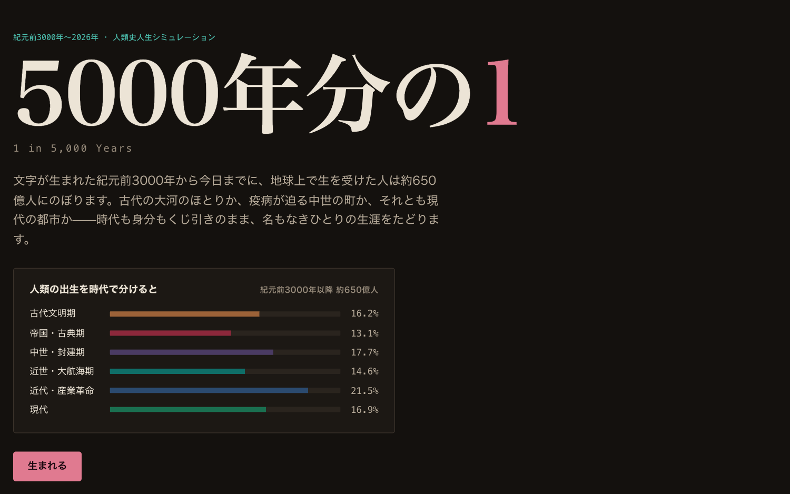
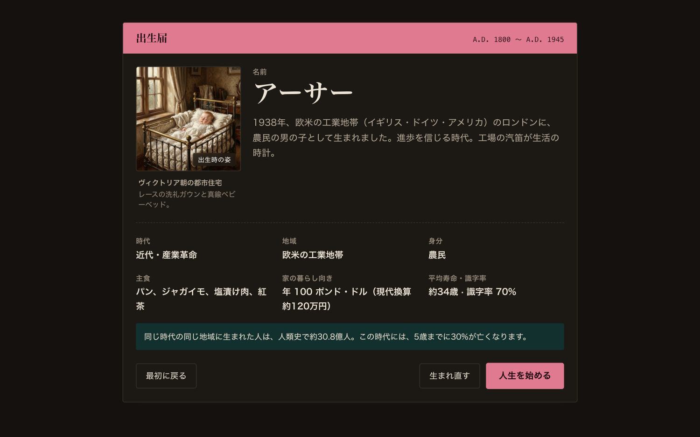
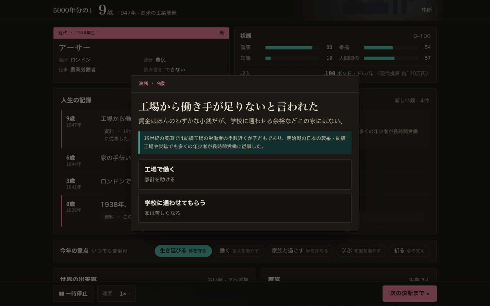
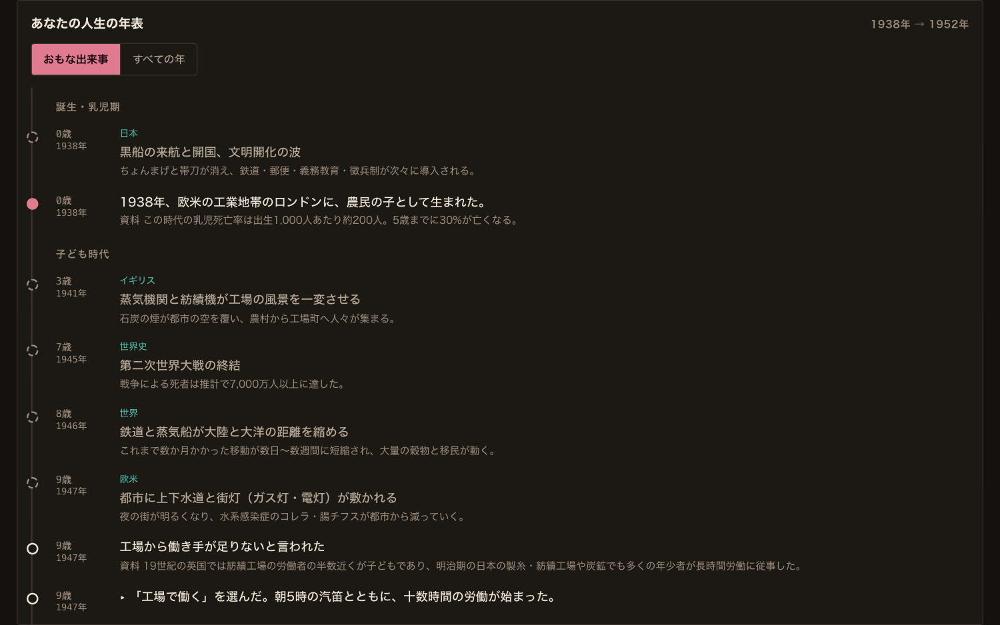
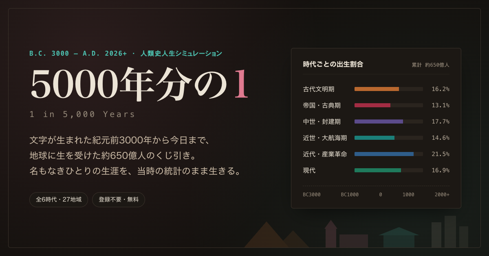

<div align="center">

# 5000年分の 1
### *1 in 5,000 Years*

**文字が生まれた紀元前3000年から今日までに地球上に生まれた推計650億人のくじ引き。**<br />
**生まれた場所だけでなく「時代」も選べない、一度きりの人類史人生シミュレーション。**

[](https://1in5ky.vercel.app/)
[](./LICENSE)
[](https://svelte.dev/)
[](https://bun.sh/)

<br />



</div>

<br />

## 📖 作品について

本作品は、世界中で話題を呼んだ人生シミュレーション[『80億分の1（1 in 8 Billion）』](https://1in8b.life/ja/)の「生まれた場所の統計から抜け出せないリアルさ」に着想を得て、**時間軸（5,000年間の人類史）**へと拡張したWebゲームです。

産業革命以降の人口爆発を反映したリアルな出生確率のもと、紀元前3000年の古代メソポタミアの農民、中世ヨーロッパの職人見習い、江戸時代の小作人、近代の工場労働者、そして2030年代以降の未知の天変地異まで——その時代・地域の実際の人口統計・生存率データに従って一度きりの人生をたどります。

登録不要・完全無料・ブラウザで5分〜10分で1人生を体験できます。

<br />

## ✨ 主な特徴

<table>
  <tr>
    <td width="50%">
      
      <h3 align="center">① 時代・地域・階層ガチャ</h3>
      <p>紀元前3000年〜現代の全6時代・27地域からランダムに誕生。時代・地域・人種・社会階層を考証した出生時の肖像画、当時の通貨と現代換算年収、5歳未満児死亡率が突きつけられます。</p>
    </td>
    <td width="50%">
      
      <h3 align="center">② 理不尽な歴史の決断</h3>
      <p>城塞都市の包囲戦、ペスト、熱湯の神判、悪税、総力戦の空襲、そして近未来の酷暑や破局噴火。当時の医療・科学水準を反映した過酷な二者択一を迫られます。</p>
    </td>
  </tr>
  <tr>
    <td width="50%">
      
      <h3 align="center">③ 一生と世界史を紡ぐ「人生の年表」</h3>
      <p>誕生から子ども時代、青年期、晩年、そして死因までをライフステージ別に可視化。同時代に世界各地で起きていた出来事や科学の進歩と並行して振り返ることができます。</p>
    </td>
    <td width="50%">
      
      <h3 align="center">④ 生命表に基づく「同世代生存統計」</h3>
      <p>「その年齢まで生きられたのは同世代の約何%か」を人口統計学の生命表から厳密に算出。死亡証明書からワンタップで波乱万丈な人生の結果を X（Twitter）へシェアできます。</p>
    </td>
  </tr>
</table>

<br />

## 🕰 収録時代区分（全6時代・27地域）

| 時代区分 | 年代 | 推計出生数 | 主な地域ブロック | 主なリスク・死因の壁 |
|---|---|---|---|---|
| **古代文明期** | B.C. 3000 〜 B.C. 501 | 105億人 (16.2%) | メソポタミア / エジプト / 黄河流域 / インダス | 乳幼児死亡率約50%、飢饉、神殿労役、脱水 |
| **帝国・古典期** | B.C. 500 〜 A.D. 499 | 85億人 (13.1%) | ローマ帝国 / 秦・漢 / インド / オリエント | 徴兵、帝国の疫病、過酷な土木工事、神判 |
| **中世・封建期** | A.D. 500 〜 A.D. 1499 | 115億人 (17.7%) | 封建ヨーロッパ / イスラム / 中国 / 日本 | ペスト（黒死病）、包囲戦、不衛生、領主支配 |
| **近世・大航海期** | A.D. 1500 〜 A.D. 1799 | 95億人 (14.6%) | 江戸日本 / 清・アジア / 欧州 / 大西洋世界 | 天明の飢饉、外来感染症、火縄銃、身分固定 |
| **近代・産業革命** | A.D. 1800 〜 A.D. 1944 | 140億人 (21.5%) | 欧米工業地帯 / 日本 / 中国 / インド | 劣悪な工場労働（児童労働）、コレラ、結核、総力戦 |
| **現代〜近未来** | A.D. 1945 〜 2026+ | 110億人 (16.9%) | 日本 / 東アジア / 南アジア / アフリカ / 欧米 | 格差、生活習慣病、50℃猛暑、破局噴火、太陽フレア |

<br />

## 🛠 技術スタック

- **Framework**: [SvelteKit 3](https://kit.svelte.dev/) (Svelte 5 Runes only)
- **Language**: [TypeScript](https://www.typescriptlang.org/) (Strict mode)
- **Runtime & Package Manager**: [Bun](https://bun.sh/)
- **Styling**: Vanilla CSS (CSS Variables, Dark mode automatic adaptation, Mobile-first)
- **Testing**: [Playwright](https://playwright.dev/) (E2E) + `bun test` (Data integrity & 3,000-life Monte Carlo invariant validation)
- **Deployment**: [Vercel](https://vercel.com/) (Edge / Serverless Node.js 24 LTS)
- **Security**: Strict Content Security Policy (Per-request Cryptographic Nonce), Hardened HTTP Headers

<br />

## 💻 ローカル開発・セットアップ

```bash
# リポジトリのクローン
git clone https://github.com/okbear/1in5ky.git
cd 1in5ky

# 依存パッケージのインストール（Bunを使用）
bun install --frozen-lockfile

# 開発サーバーの起動 (http://localhost:5199)
bun run dev --port 5199

# 型チェック（警告ゼロ厳格モード）
bun run check

# 単体テスト & 不変条件モンテカルロ検証
bun test

# 本番ビルド検証
bun run build

# E2Eスモークテスト（Playwright）
bun run test:e2e
```

<br />

## 📜 クレジット & 免責事項

- **着想元**: 本作品は [Jin’s Earth](https://1in8b.life/) 様制作の『80億分の1（1 in 8 Billion）』に着想を得て個人が独自に制作した非公式のシミュレーションゲームです。
- **データ出典**: 歴史人口推計、各国平均寿命、乳児・5歳未満児死亡率、識字率などの基礎統計は [Our World in Data](https://ourworldindata.org/)、Maddison Project Database、国連世界人口推計（UN WPP）等の公開データを参考にモデル化しています。
- **プライバシー**: 個人情報の収集やクッキーの利用は行っていません。プレイ記録（メモリアル）はお使いのブラウザ（`localStorage`）内にのみ保持されます。

<br />

<div align="center">

Released under the [MIT License](./LICENSE).

</div>
