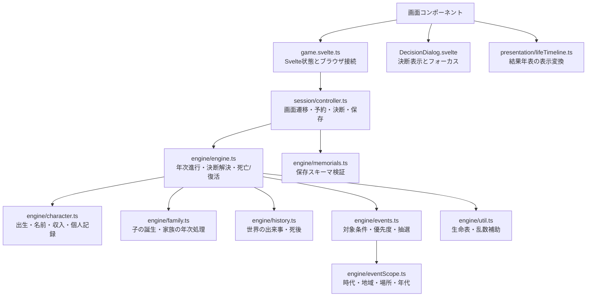

# 構造レビューとリファクタリング

> この文書は前段階の監査記録です。その後の97地域化・家族モデル・現在年・出典・時代別読み込みの実装は [モデルv2](./model-v2.md) を参照してください。

## レビュー範囲

画面遷移、Svelteの状態管理、年次シミュレーション、イベント抽選と決断、家族、生命表、メモリアル保存、地域・歴史データの集約、結果画面の表示変換、単体・E2Eテストを確認した。

ゲームの確率や歴史データの再調整は今回の目的に含めない。地域の混在・暫定統計は [地域監査](./scenario-region-audit.md) を参照。

## 発見事項と対応

| 優先度 | 変更前の問題 | 今回の対応 |
| --- | --- | --- |
| 高 | `Game.choose` は現在の決断を確認せず、渡された任意の選択肢の効果を適用できた。決断解消後の二重呼び出しも受け付けた | 人生進行中・生存中・保留中の決断が所有する選択肢だけを許可。偽の効果、古い選択肢、二重適用を拒否するテストを追加 |
| 高 | タイマー、ブラウザ保存、Svelteの状態、画面遷移が同じクラスにあり、進行制御の単体テストができなかった | 通常のTypeScriptの `SessionController` に遷移を移し、乱数・予約処理・ストレージを注入。Svelte側はリアクティブ状態とブラウザ機能を渡す薄い接続層にした |
| 中 | 通常進行と早送りで、終了・決断の処理が重複。状態にかかわらず予約や開始を実行でき、再生速度も任意の数値を受け付けた | 共通の1年遷移に集約し、タイマーは最大1つ。進行中・生存・決断なし・一時停止なしの条件でのみ予約。速度は画面と共通の許可値を使う |
| 中 | 542行の `engine.ts` に出生・記録・家族・歴史・抽選・年次進行・決断解決が集中 | 出生・人物補助、家族、歴史、イベント抽選を分割。`engine.ts` は192行で進行順と決断・死亡処理を担う。既存の公開インポートは再エクスポートで維持 |
| 中 | 成人死亡ハザードの較正キャッシュが地域IDだけをキーとしており、同じIDの統計を変更したプロファイルで古い値を再利用した | 較正が実際に依存する `lifeExpectancyAt15` をキーに変更。短命・長命の同一IDプロファイルを交互に使う回帰テストを追加 |
| 中 | メモリアルの出生年・没年・享年を別々に検査し、相互矛盾やゲーム上限を超える享年を受け付けた | `deathYear - birthYear === deathAge` と `MAX_AGE` を検査。正当な既存レコードは従来どおり読み込む |
| 中 | `Life.svelte` にモーダルの描画、挿絵、初期フォーカス、閉じる処理、見た目が混在。キーボードフォーカスは循環しなかった | `DecisionDialog.svelte` に分離。親は背景と「決断に戻る」を管理し、モーダルは表示・Escape・Tab循環を管理。復帰はSvelteの `tick()` 後に実行 |
| 中 | 決断モーダルのE2Eは「決断が一度も出なかった場合」も検査せず成功した | 決断に到達する固定乱数の人生を使用し、表示、非表示、背景のinert解除、復帰、選択、キーボード操作を必須検査にした |
| 低 | 結果画面が年表のマージ・同年内の並べ替え・ライフステージ・表示範囲の変換も担当 | 純粋な `presentation/lifeTimeline.ts` に分離。入力を変更しないこと、世界史優先、重要イベントのみの表示を単体テスト |
| 低 | 地域の時代別登録と全地域一覧を別々に手書きし、登録漏れを起こせる | 全地域一覧を `ERA_ORDER` と時代別登録から導出 |
| 低 | メモリアル保存が初期墓標を得るために世界史集約モジュールへ依存 | 初期墓標を `data/seeds.ts` に集約。既存の `timeline.ts` からの参照は再エクスポートで維持 |
| 低 | `bun run test` が1ファイルを指定していて、新しい単体テストが通常の検証から漏れる | `bun test src/lib` に変更 |

## 変更後の責務

`SessionController` はSvelteや `window`、`localStorage` を参照しない。状態オブジェクト、乱数、予約・キャンセル機能、任意のストレージを受け取る。ゲームの数値計算は `engine` に置き、コントローラーが確率を補正することはしない。

`engine/engine.ts` の `stepYear` は処理順を読む入口として残す。細かい関数を無制限にファイル化する変更は行わず、画面ファイルにも、それぞれの画面専用のレイアウト・CSSを残した。

## 挙動を維持する検証

- 分割前に6時代×4シードの24人生を記録。最終人物状態、個人記録、家族、世界史、発火済みイベントを含むハッシュ、乱数呼び出し数、決断数が変更後も一致する。
- 既存の3,000人生シミュレーション、乳児・5歳未満ハザード、地域隔離、ストレージ検査を維持。
- 一時停止、速度変更、タイマー重複防止、無効・二重決断、通常進行と早送りの一致、死亡・復活後の墓標置換、ストレージ拒否を単体テスト。
- メモリアル相互整合性、較正キャッシュ、表示年表の回帰テストを追加。
- `bun run check`：エラー・警告0。
- `bun run test` / `bun test`：56件成功。
- `bun run build`：成功。約584 kBのクライアントチャンクに対するサイズ警告は残る。
- `bun run test:e2e`：デスクトップ・モバイル合わせて8件成功。

人生トレースのフィクスチャは `engine/fixtures/life-traces.json`。確率やデータを意図的に変えるとハッシュが変わるため、将来の変更では乱数の呼び出し回数・決断数・履歴の差を確認してから期待値を更新する。既存の不具合を仕様として固定する意図ではない。

## 残る設計課題

### 1. 出生した時代と、現在の制度・文化を同じ参照で扱っている

人物は出生時の `era` / `region` を保持し、イベント適用や世界史候補も主にその参照に依存する。時代境界をまたいでも現在の制度へ自動的に変わる仕組みはない。出生プロフィールと、その年の政治体制・法制度・生活環境を分ける設計が必要。

これは歴史データ・生命表・イベントの意味を変えるため、責務を分ける今回の変更と一緒にゲーム挙動を変えなかった。

### 2. イベントの規則にID文字列への依存が残る

`childbirth_` 接頭辞で出産の待機期間・子ども上限を判定し、`mourn_and_continue` という選択肢IDで訃報記録を判定している。今後はライフサイクル種別・待機年数・記録種別を明示的なデータにして、IDの改名で規則が変わらないようにする。今回、抽選を `engine/events.ts` に隔離したので変更点は絞られている。

### 3. 家族の年齢と続柄の表現が弱い

`relation: string` と、意味の異なる `ageAtPlayerBirth` / `birthPlayerAge` の任意フィールドで親・兄弟姉妹・配偶者・子を表現する。出生前の年齢や子どもの年次死亡判定と、兄弟姉妹の判定に非対称性がある。続柄の判別可能な型と本人の出生年を基準とした表現へ移すには、家族の仕様を先に決める必要がある。

### 4. 歴史データを一括で読み込んでいる

全地域・全イベント・全時代の世界史が同期インポートされ、約584 kBのクライアントチャンクが残る。単純に圧縮警告の閾値を上げる対応はしていない。時代別ロードの境界は作りやすくなったが、誕生・早送りの同期APIをどう維持するか、先読みとローディングの扱いを決めてから実装する。

### 5. 地域・制度・文化の細分化と地名ID

[地域監査](./scenario-region-audit.md) の国別制度・人名・通貨・暫定統計の課題は引き続き残る。局所イベントの `places` が表示文字列を参照する点も、将来は出生地IDと表示名を分けたい。今回の構造整理で歴史データの正確性がすべて保証されたわけではない。

## 変更時の指針

1. 数値や発火条件の変更はエンジン、画面遷移とタイマーはコントローラー、ブラウザ機能への接続は `game.svelte.ts` に置く。
2. 画面に渡す並び替え・集計は、複雑になった段階で純粋な表示関数にする。
3. 歴史データや確率を変える変更と、責務を分ける変更は検証上区別する。
4. 新しい単体テストは `src/lib` 内に置き、通常の検証コマンドから実行されるようにする。
